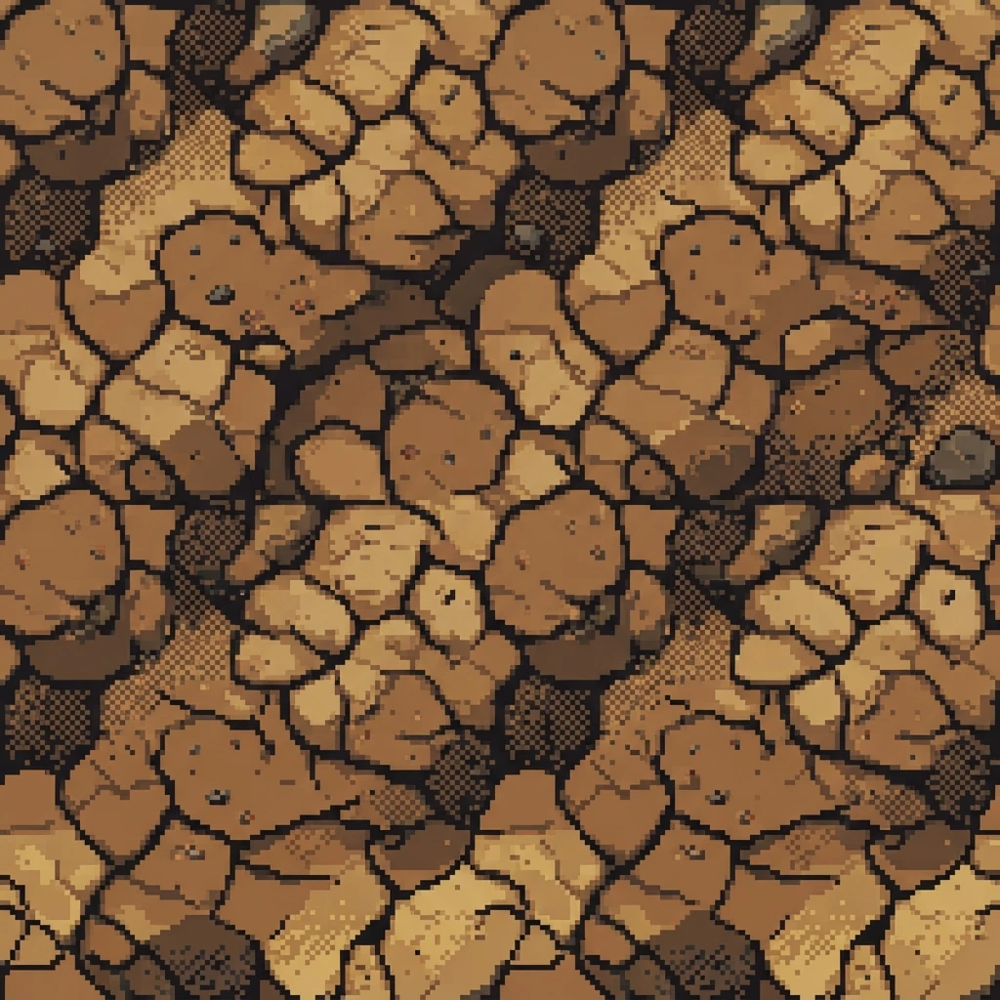

# 🛡️ Wasteland Bunker Defense

[](https://github.com/hoangAn01/wasteland-bunker-defense/actions/workflows/deploy.yml)
[](https://hoangan01.github.io/wasteland-bunker-defense/)
[](https://react.dev/)
[](https://vitejs.dev/)
[](https://tailwindcss.com/)
[](./THIRD_PARTY_NOTICES.md)

> A post-apocalyptic tactical tower defense game built with **React 19**, **HTML5 Canvas**, and **Tailwind CSS**. Command specialized turret variants, research Tech Lab mods, and counter dangerous monster affixes across 20 escalating waves.

🎮 **[Click here to Play Live on GitHub Pages!](https://hoangan01.github.io/wasteland-bunker-defense/)**

---

## 📸 Overview



In **Wasteland Bunker Defense**, you defend the last human command bunker against mutated wasteland hordes:
* **20 Escalating Waves**: Battle through Walkers, Sprinters, massive Behemoths, and colossal Stage Bosses.
* **Dual Language Support**: Seamless bilingual toggle between **English** and **Tiếng Việt**.
* **Procedural Sprites & Audio**: Full spritesheet animations for mutants and dynamic wasteland atmospheric BGM.
* **Interactive Tactical HUD**: Real-time wave callers (+bonus scrap), orbital strikes, turret specialization branches, and Tech Lab weapons research.

---

## 🚀 Key Features

### 1. Defense Turrets & Variants
- **Autocannon (Pháo Tự Động - 100 Scrap)**: High-rate single-target ballistic cannon. Specializes into Twin-Barrel Gatling or Armor-Piercing Slugger.
- **Cryo Emitter (Tia Băng Giá - 150 Scrap)**: Area-of-effect cryogenic beam slowing down mutant swarms. Specializes into Deep Freeze or Blizzard Emitter.
- **Road Mine (Mìn Đường Bộ - 60 Scrap)**: Deployed directly onto road tiles. Triggers high instant detonation damage on contact. Specializes into Cluster Mines or EMP Disrupter.
- **Mortar Launcher (Súng Cối - 220 Scrap)**: Long-range ballistic shells dealing heavy explosive AOE damage. Specializes into Napalm Payload or Siege Cannon.

### 2. Monster Types & Affixes
- **Walker**: Standard resilient wasteland infected.
- **Sprinter**: High-speed flankers that bypass slow defenses.
- **Behemoth**: Heavy armored juggernauts capable of soaking intense damage.
- **Boss**: Devastating threat with unique abilities and massive HP bars.
- **Dangerous Affixes**:
  - 🛡️ **Armored**: Takes reduced incoming kinetic damage.
  - ⚡ **Swift**: Moves 40% faster.
  - 🔮 **Shielded**: Absorbs initial hits before taking health damage.
  - 💚 **Regenerator**: Continuously heals over time.
  - 💥 **Unstable**: Explodes violently upon destruction, potentially affecting nearby units.

### 3. Tech Lab & Tactical Support
- **Tech Lab Upgrades**: Spend scrap metal to boost fire rate, projectile velocity, blast radius, and cryogenic duration.
- **Orbital Strike (Oanh Kích Quỹ Đạo)**: Emergency satellite beam bombardment wiping out entire clusters of mutants.
- **Wave Caller**: Call upcoming waves early to earn extra scrap bounty rewards.

---

## 🕹️ Controls & Hotkeys

| Action | Control |
| :--- | :--- |
| **Select / Deploy Turret** | Left Click on build menu & click tile |
| **Inspect / Upgrade Turret** | Left Click placed turret |
| **Targeting Priority** | Switch between `FIRST`, `STRONGEST`, `WEAKEST`, `LAST` |
| **Orbital Strike** | Click Orbital Strike button |
| **Speed Toggle** | `1x Speed` / `2x Speed` toggle in top bar |
| **Cancel Selection** | `Escape` or click empty ground |
| **Audio Toggle** | Click sound icon in top HUD |

---

## 💻 Tech Stack

* **Framework**: [React 19](https://react.dev/)
* **Bundler & Dev Server**: [Vite 6](https://vitejs.dev/)
* **Rendering Engine**: HTML5 2D Canvas with custom Sprite Renderer & Fixed-step stepper
* **Styling**: [Tailwind CSS 3](https://tailwindcss.com/)
* **Icons**: [Lucide React](https://lucide.dev/)
* **Language**: TypeScript

---

## 🛠️ Local Development

### Prerequisites
* [Node.js](https://nodejs.org/) v18 or newer
* npm v9 or newer

### Installation

1. **Clone the repository:**
   ```bash
   git clone https://github.com/hoangAn01/wasteland-bunker-defense.git
   cd wasteland-bunker-defense
   ```

2. **Install dependencies:**
   ```bash
   npm install
   # Or on Windows PowerShell if execution policies apply:
   npm.cmd install
   ```

3. **Start the development server:**
   ```bash
   npm run dev
   # Or on Windows PowerShell:
   npm.cmd run dev
   ```
   Open [http://localhost:5173](http://localhost:5173) in your browser.

4. **Build for Production:**
   ```bash
   npm run build
   # Or on Windows PowerShell:
   npm.cmd run build
   ```
   Production assets will be output to the `dist/` directory.

---

## 🌐 GitHub Pages Deployment

The repository is configured with an automated **GitHub Actions** deployment pipeline ([`.github/workflows/deploy.yml`](.github/workflows/deploy.yml)).

Whenever changes are pushed to the `main` branch:
1. GitHub Actions automatically installs dependencies.
2. Builds the optimized production bundle with Vite.
3. Deploys the application directly to GitHub Pages at:
   👉 **[https://hoangan01.github.io/wasteland-bunker-defense/](https://hoangan01.github.io/wasteland-bunker-defense/)**

---

## 📄 License & Credits

* Original game concept & assets from Wasteland Bunker Defense.
* Third-party open-source components and licenses are documented in [THIRD_PARTY_NOTICES.md](./THIRD_PARTY_NOTICES.md).
